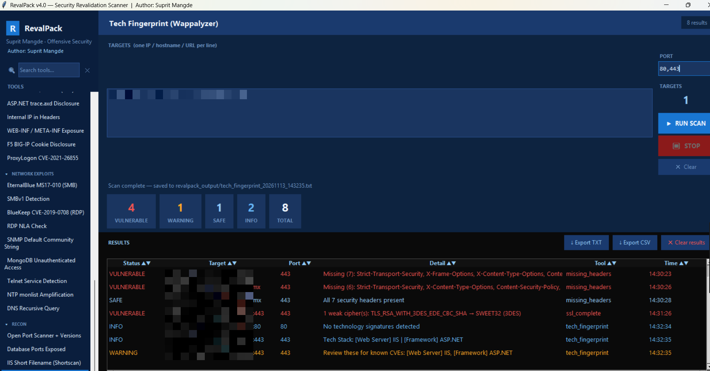
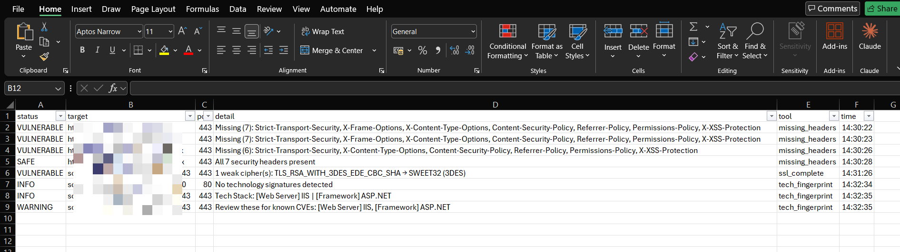

# RevalPack — Security Revalidation Scanner

<p align="center">
  
  
  
  
  
</p>

> **RevalPack** is a standalone GUI-based security revalidation scanner built for offensive security professionals. It consolidates **51 vulnerability checks** into a single desktop application — no browser, no server, no internet required.

---

## 📸 Screenshot

### Main Interface


### Scan Results


---

## 🔥 Features

- **51 built-in scan modules** across 9 categories
- **Multiport support** — scan multiple ports at once (e.g. `80,443,8080`)
- **Collapsible sidebar** with live search and mouse-wheel scrolling
- **Stop button** — cancel a running scan mid-way
- **Sortable results** — click any column header (Status, Target, Port, Detail, Tool, Time)
- **Tech Fingerprinting** — detect web server, framework, CMS, JS libs, CDN/WAF (Wappalyzer-style)
- **Retire.js scanner** — detect outdated/vulnerable JavaScript libraries (jQuery, Bootstrap, Angular, etc.)
- **Real-time results** with VULNERABLE / WARNING / SAFE / INFO / ERROR classification
- **Export** results as TXT or CSV
- **Auto-save** every scan to `revalpack_output/` folder
- **Build to EXE** — single-file portable executable (no Python needed on target machine)
- **Pure Python** — no external binary dependencies for most checks

---

## 🛠️ Tool Categories & Modules

### SSL/TLS (5 tools)
| Tool | Description |
|------|-------------|
| TLS Version Checker | Detects TLS 1.0, 1.1, 1.2, 1.3 support |
| SSL Complete Audit | Tests all cipher suites |
| Vuln Ciphers: BEAST/BREACH/RC4 | BEAST, BREACH, CRIME, LUCKY13, POODLE, SWEET32, FREAK, LOGJAM, RC4, NULL/ANON |
| SWEET32 / 3DES Check | CVE-2016-2183 |
| TLS v1.0–1.3 per-URL | Threaded multi-URL protocol check |

### SSL/TLS Certificates (5 tools)
| Tool | CVE |
|------|-----|
| SSL Cert Expiry Check | — |
| SSL Weak Hash (MD5/SHA1) | CVE-2004-2761 |
| SSL Untrusted Certificate | — |
| SSL Insecure Renegotiation | CVE-2009-3555 |
| Heartbleed | CVE-2014-0160 |

### HTTP Headers (5 tools)
| Tool | Description |
|------|-------------|
| Missing Security Headers | HSTS, CSP, X-Frame-Options, etc. |
| HSTS Check | Strict-Transport-Security presence and max-age |
| Clickjacking Protection | X-Frame-Options / frame-ancestors |
| Server Version Disclosure | Server / X-Powered-By leakage |
| Server Version (SSL bypass) | Same check over HTTPS |

### HTTP Exploits (6 tools)
| Tool | CVE |
|------|-----|
| HTTP TRACE/TRACK (XST) | — |
| ASP.NET trace.axd Disclosure | — |
| Internal IP in Headers | RFC1918 IP disclosure |
| WEB-INF / META-INF Exposure | — |
| F5 BIG-IP Cookie Disclosure | — |
| ProxyLogon | CVE-2021-26855 |

### Auth/Methods (3 tools)
| Tool | Description |
|------|-------------|
| Basic Authentication Detection | Unencrypted Basic Auth |
| HTTP Dangerous Methods | OPTIONS, PUT, DELETE exposure |
| ASP.NET Debug Mode | X-AspNet-Version debug headers |

### Web App (11 tools)
| Tool | Description |
|------|-------------|
| crossdomain.xml Policy | Flash/Silverlight overly permissive policy |
| clientaccesspolicy.xml | Silverlight cross-domain policy |
| Directory Listing Detection | Apache/IIS directory listing |
| jQuery Version Detection | Outdated jQuery |
| jQuery (SSL bypass) | Same over HTTPS |
| Server / X-Powered-By Header | Technology disclosure |
| HTTP vs HTTPS (Unencrypted) | Plain HTTP exposure |
| PHP Version Disclosure | PHP version in headers/body |
| Apache Server Version Disclosure | Full Apache banner with OS/module info |
| **Retire.js Vuln JS Libraries** 🆕 | Detects vulnerable jQuery, Bootstrap, Angular, React, Lodash, Moment, Vue |
| **Tech Fingerprint (Wappalyzer)** 🆕 | Web server, framework, CMS, JS libs, CDN/WAF detection |

### Network / Host (4 tools)
| Tool | Description |
|------|-------------|
| SSH Weak Algorithms | Weak MACs, ciphers, KEX |
| SMB Signing Check | Missing/not-required SMB signing |
| Apache Tomcat Detection | Manager/status page exposure |
| SMB Null Session Check | Anonymous SMB bind — CVE classic |

### Network Exploits (9 tools)
| Tool | CVE |
|------|-----|
| EternalBlue MS17-010 (SMB) | CVE-2017-0143 |
| SMBv1 Detection | CVE-2017-0143 |
| BlueKeep (RDP) | CVE-2019-0708 |
| RDP NLA Check | — |
| SNMP Default Community String | — |
| MongoDB Unauthenticated Access | — |
| Telnet Service Detection | — |
| NTP monlist Amplification | CVE-2013-5211 |
| DNS Recursive Query | — |

### Recon (3 tools)
| Tool | Description |
|------|-------------|
| Open Port Scanner + Versions | Fast threaded port scan with service/banner detection |
| Database Ports Exposed | Checks MySQL, MSSQL, Oracle, Redis, MongoDB, etc. exposed to internet |
| IIS Short Filename (Shortscan) | IIS 8.3 filename enumeration via tilde (~) wildcard — CVE-2010-2730 |

---

## 🚀 Quick Start

### Option 1 — Run from Python

```bash
# Install dependencies
pip install requests beautifulsoup4 urllib3

# Run the GUI
python revalpack_gui.py
```

### Option 2 — Build to EXE (Windows)

```bat
# Double-click BUILD_EXE.bat  OR  run in CMD:
BUILD_EXE.bat
```

The EXE will appear in `dist\RevalPack.exe` — copy it anywhere and run it.

---

## 📋 Requirements

```
Python 3.8+
requests
beautifulsoup4
urllib3
```

---

## 🎮 How to Use

1. **Select a tool** from the left sidebar (click any group header to collapse/expand)
2. **Search tools** using the search box at the top of the sidebar
3. **Enter targets** — one per line (IP, hostname, or URL)
4. **Set port** — auto-filled from tool default; supports **multiple ports** e.g. `80,443,8080`
5. Click **▶ RUN SCAN**
6. Click **⏹ STOP** to cancel mid-scan
7. **Click any column header** to sort results (Status, Target, Port, Detail, Tool, Time)
8. **Export** results as TXT or CSV

**Target formats accepted:**
```
10.0.32.41
192.168.1.1-10
example.com
https://example.com
http://10.0.0.1:8080
```

---

## 📁 Output

Results are auto-saved to `revalpack_output/` next to the executable:
```
revalpack_output/
  tls_version_20241104_143022.txt
  tech_fingerprint_20241104_143155.txt
  ...
```

---

## ⚠️ Legal Disclaimer

> This tool is intended for **authorized security testing only**.  
> Always obtain **written permission** before scanning any system you do not own.  
> The author assumes no liability for misuse of this tool.  
> Use responsibly and in compliance with all applicable laws.

---

## 👤 Author

**Suprit Mangde**  
Senior Analyst – Offensive Security

---

## 📄 License

MIT License — see [LICENSE](LICENSE)

---

## 🙏 Credits

- Inspired by [FastVulnVerify](https://github.com/0xhav0c/FastVulnVerify) by 0xhav0c
- SSL checks modeled after [testssl.sh](https://github.com/drwetter/testssl.sh) methodology
- JS vulnerability data based on [Retire.js](https://retirejs.github.io/retire.js/) project
- Tech fingerprinting inspired by [Wappalyzer](https://www.wappalyzer.com/)